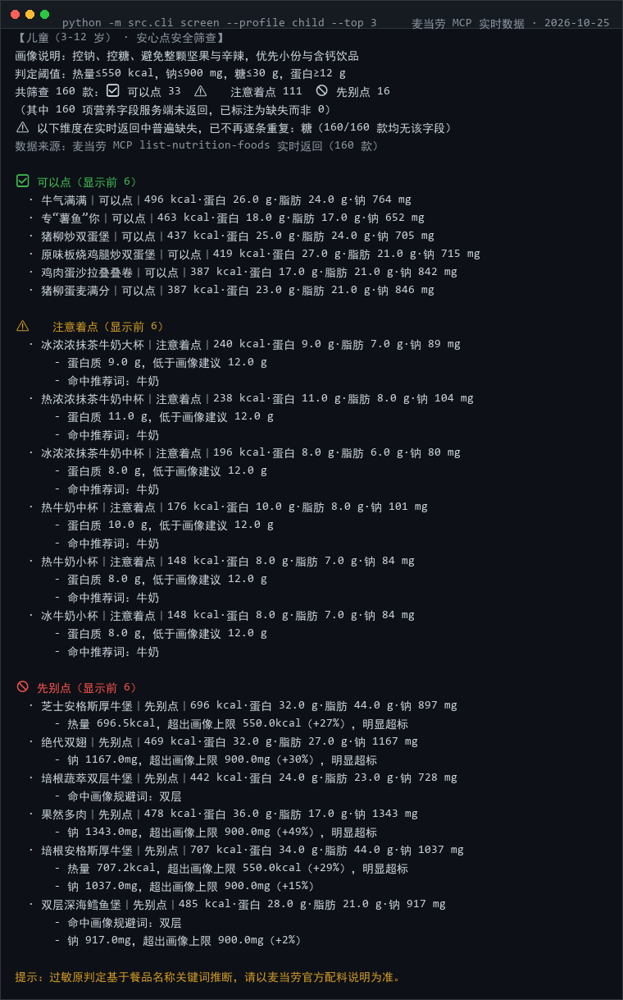
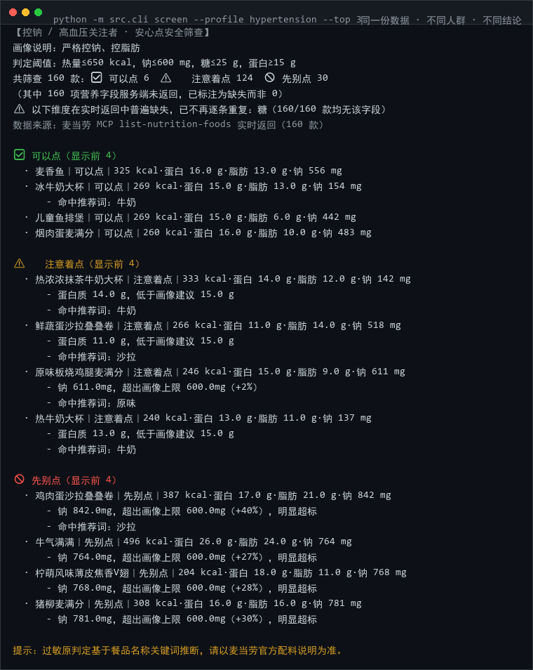

# 🍔 mcd-safe-order · 麦麦安心点

> ⭐ **觉得有用就点个 Star** —— 本项目正在参加麦当劳程序员创意开发大赛，排名唯一依据就是 Star 数。**零依赖、可离线运行，无需 Token 也能验证。**


> 给「不能随便吃」的人做的一把尺子：儿童、老人、孕产妇、减脂、控钠、控糖、素食偏好。
> 拉麦当劳 MCP 的**真实营养数据**，按人群画像规则跑一遍，输出 **可以点 / 注意着点 / 先别点** 三档结论，并给出替代建议。

**如果只能看一行**：不是"推荐吃什么"，而是"这口到底能不能放心吃"——并且每条结论都附得出处。

```
$ python -m src.cli screen --profile child --top 3 --offline

【儿童（3-12 岁） · 安心点安全筛查】
画像说明：控钠、控糖、避免整颗坚果与辛辣，优先小份与含钙饮品
判定阈值：热量≤550 kcal，钠≤900 mg，糖≤30 g，蛋白≥12 g
共筛查 30 款：✅ 可以点 6　⚠️ 注意着点 18　🚫 先别点 6

✅ 可以点
  · 板烧鸡腿堡｜404 kcal·蛋白 24.0 g·脂肪 20.0 g·钠 900 mg
  · 开心乐园餐-吉士汉堡｜380 kcal·蛋白 16.0 g·脂肪 15.0 g·钠 780 mg
  · 麦香鸡｜360 kcal·蛋白 15.0 g·脂肪 19.0 g·钠 720 mg

🚫 先别点
  · 巨无霸｜550 kcal·钠 1020 mg
      - 命中画像规避词：巨无霸
      - 钠 1020mg，超出画像上限 900mg（+13%）
  · 麻辣鸡翅(2块)
      - 疑似含「辛辣」类成分（命中词：辣、麻辣，来自名称推断）
```

> 上面这段是 `--offline` 样例快照跑出来的结果；装上 Token 后同样命令会换成服务端实时数据。

---

## 🔴 实时实测（2026-10-25，真实 MCP 调用）

```
$ python -m src.cli screen --profile child --top 3

【儿童（3-12 岁） · 安心点安全筛查】
判定阈值：热量≤550 kcal，钠≤900 mg，糖≤30 g，蛋白≥12 g
共筛查 160 款：✅ 可以点 33　⚠️ 注意着点 111　🚫 先别点 16
⚠ 以下维度在实时返回中普遍缺失，已不再逐条重复：糖（160/160 款均无该字段）
数据来源：麦当劳 MCP list-nutrition-foods 实时返回（160 款）

✅ 可以点
  · 牛气满满｜496 kcal·蛋白 26.0 g·脂肪 24.0 g·钠 764 mg
  · 专“薯鱼”你｜463 kcal·蛋白 18.0 g·脂肪 17.0 g·钠 652 mg
  · 猪柳炒双蛋堡｜437 kcal·蛋白 25.0 g·脂肪 24.0 g·钠 705 mg

🚫 先别点
  · 芝士安格斯厚牛堡｜696 kcal·蛋白 32.0 g·脂肪 44.0 g·钠 897 mg
      - 热量 696.5kcal，超出画像上限 550.0kcal（+27%），明显超标
  · 绝代双翅｜469 kcal·蛋白 32.0 g·脂肪 27.0 g·钠 1167 mg
      - 钠 1167.0mg，超出画像上限 900.0mg（+30%），明显超标
```





**这条实测暴露了三个真实接口问题，本项目如实处理而不是掩盖：**

1. **`data` 不是数组而是伪表格字符串**（`[160]{productName,energyKcal,...}:\n 值,值,...`）——`nutrition.parse_pseudo_table()` 专门解析它；
2. **「糖」这一列 MCP 根本没返回**（160/160 全缺）——不按 0 算，全局提示一次，且不影响其他维度判定；
3. **kJ 与 kcal 混用**（`energyKj`/`energyKcal` 两列并存）——自动按 kJ 换算，有单测守着。

控钠画像（`hypertension`）下同样的实时数据会给出截然不同的结论：麦香鱼 ✅ 可以点（钠 556mg），而儿童画像下的"可以点"牛气满满（钠 764mg）在这里直接 🚫 先别点 —— **同一份数据、不同人群、不同答案**，这正是本项目存在的意义。

---

## 它解决什么问题

带娃的、控糖的、孕期的、血压偏高的……在麦当劳点餐时真正难的不是"想吃啥"，而是三件事同时算：

| 用户真实在问 | 现状 | 本项目的回答 |
|---|---|---|
| 这个汉堡我爸能吃吗？ | 得自己翻营养表、一项项比 | 一句话结论 + 超了哪一项、超了多少 |
| 我对花生过敏，菜单里哪些安全？ | 官方营养表不含过敏原字段 | 基于名称关键词做**推断筛查**，并明确标注是推断 |
| 三高/孕期这顿怎么搭？ | 没有面向特殊人群的现成答案 | 7 套人群画像，阈值全部写在 `src/profiles.py` 里可改、可审计 |

大模型做算术并不可靠，所以这里的分工是：**取数交给 MCP，判定交给确定性 Python 规则**。整个 `screener.py` 是一个纯函数式的规则引擎，没有任何"让它看着办"。

---

## 架构

```
┌──────────────────┐     ┌────────────────────────┐     ┌───────────────────┐
│  麦当劳 MCP      │────▶│  nutrition.py 归一化    │────▶│  screener.py      │
│ list-nutrition-  │     │  kJ⇄kcal / 中英文字段  │     │  三档规则引擎     │
│ foods / query-meals│    │  / 带单位字符串解析    │     │  GREEN/YELLOW/RED │
└──────────────────┘     └────────────────────────┘     └─────────┬─────────┘
                                                                  │
                          ┌────────────────────────┐              │
                          │  profiles.py 人群画像   │─────────────▶│
                          └────────────────────────┘              ▼
                                                     ┌────────────────────────┐
                                                     │  report.py             │
                                                     │  终端文本 / HTML 卡片  │
                                                     └────────────────────────┘
```

---

## 安装（零依赖，Python 3.8+ 标准库）

```bash
git clone https://github.com/susevenci/mcd-safe-order.git
cd mcd-safe-order
# 无需 pip install 任何东西
```

**① 先确认能跑**

```bash
python -m src.cli profiles                    # 看有哪 7 套人群画像
python -m src.cli screen --profile child --offline    # 离线示例，立刻出结果
```

**② 接真实数据**（申请：[麦当劳 MCP 开放平台](https://open.mcd.cn/mcp) → 控制台 → 激活 → 复制 Token）

```bash
cp .env.example .env        # 编辑填入：MCD_MCP_TOKEN=你的Token
# Windows PowerShell: $env:MCD_MCP_TOKEN="你的Token"
python -m src.cli selfcheck
python -m src.cli screen --profile elder --top 10
```

---

## 使用示例

**① 给爸妈点餐（老年画像，控钠控脂）**

```bash
python -m src.cli screen --profile elder --top 5
```

```
【老年人 · 安心点安全筛查】
判定阈值：热量≤600 kcal，钠≤800 mg，糖≤25 g，蛋白≥15 g
共筛查 160 款：✅ 可以点 41　⚠️ 注意着点 73　🚫 先别点 46
```

**② 完全自定义的阈值**

```bash
python -m src.cli screen --profile custom \
  --max-kcal 500 --max-sodium 700 --avoid-allergen 花生坚果,海鲜鱼类
```

**③ 主食 + 饮品组合推荐（都在阈值内才出）**

```bash
python -m src.cli combo --profile fatloss --top 3
```

**④ 出一张能发朋友圈的报告**

```bash
python -m src.cli screen --profile pregnant --html output/安心点报告.html
# 单文件 HTML，内联 CSS，无 CDN；可直接丢 GitHub Pages
```

**⑤ 留一份自己的数据快照**

```bash
python -m src.cli snapshot --out output/nutrition_snapshot.json
```

---

## 真实性对照表

这个比赛最容易被"看着很厉害"糊弄过去，所以这里逐条说清楚：

| 内容 | 状态 | 说明 |
|---|---|---|
| 三档判定算法 | ✅ 真实 | `screener.py` 纯 Python 规则，18 项单测覆盖，结果可复现 |
| MCP 数据链路 | ✅ 真实 | 默认走 `list-nutrition-foods` 实时数据，失败会自动回落并**在 stderr 明确提示**；已实测 160 款餐品实时返回 |
| 伪表格解析 | ✅ 真实 | 实测 `data` 为 `[160]{列名}: 值,值...` 形式的字符串，`parse_pseudo_table()` 已适配 |
| kJ ⇄ kcal | ✅ 真实 | 实时返回同时含 `energyKj` 与 `energyKcal` 两列，按 kJ 自动换算 |
| 字段缺失处理 | ✅ 真实 | 缺失项标为「数据缺失」，**绝不按 0 参与计算**（有单测守着） |
| 单位换算 | ✅ 真实 | kJ ⇄ kcal 自动识别；异常大值（>3000）按 kJ 处理 |
| `samples/*.json` 的数值 | 🟡 示例快照 | 离线演示用人工整理数据，**不是官方实时数据**，文件头有标注 |
| 上面的终端输出 | 🟡 离线样例 | README 中的演示输出来自 `--offline` 样例，实时数据条数与结论会不同 |
| 过敏原判定 | ⚠️ 推断 | MCP 未提供官方过敏原字段，基于**餐品名称关键词**推断，仅供参考，请到店核实 |

---

## 参赛合规自查

| 官方要求 | 本仓库 |
|---|---|
| README.md | ✅ |
| CONTEST_DECLARATION.md | ✅ 官方原文，内容未改动 |
| MCP_INTEGRATION.md | ✅ |
| mcp-config.example.json | ✅ 仅 `${MCD_MCP_TOKEN}` 占位符 |
| workbuddy.md | ✅ 用于 WorkBuddy 专项奖励核验 |
| 仓库 Public | 需 Owner 自行确认 |
| 项目创建时间 ≥ 2025-12-25 | 需 Owner 自行确认 |
| 不含真实 Token / 密钥 / 个人信息 | ✅ `.gitignore` 排除 `.env`，全仓无硬编码凭证 |
| 内容合规 | ✅ 全仓无贬损麦当劳品牌或与其他品牌对比的表述 |
| 不含判定作弊/刷榜逻辑 | ✅ 无任何自动化刷取行为 |

---

## 目标用户

- 给娃点餐、给父母点餐的普通消费者
- 有忌口 / 过敏史、需要提前排雷的人
- 孕期、减脂期、控糖控钠人群
- 想看「营养数据如何被规则化」的 MCP / Agent 开发者

---

## 目录结构

```
mcd-safe-order/
├── README.md · CONTEST_DECLARATION.md · MCP_INTEGRATION.md
├── mcp-config.example.json · workbuddy.md · LICENSE · .gitignore
├── skill/SKILL.md          # WorkBuddy Skill 定义
├── src/
│   ├── mcp_client.py       # 零依赖 Streamable HTTP JSON-RPC 客户端（节流 + 429 退避）
│   ├── nutrition.py        # 营养数据归一化：kJ⇄kcal / 中英文字段 / 带单位字符串
│   ├── profiles.py         # 7 套人群画像 + 10 类忌口关键词表
│   ├── screener.py         # 三档规则引擎 + 组合推荐
│   ├── report.py           # 终端文本 + 单文件 HTML 卡片
│   └── cli.py              # 命令行入口
├── tests/test_screener.py  # 18 项离线单测
└── samples/nutrition_sample.json   # 离线示例快照（已标注）
```

## 测试

```bash
python -m unittest discover -s tests -p "test_*.py"   # 18 项，无需 Token
```

## 免责

本项目为**麦当劳程序员节创意开发大赛参赛作品，非麦当劳官方产品**。输出不构成医疗、营养或其他专业建议；餐品信息、营养成分及供应状态以麦当劳官方渠道的实时结果为准。过敏相关结论务必以官方配料说明为准。

MIT © 2026

---
## 作者的另外三个参赛作品
- [麦门抽奖情报局](https://github.com/susevenci/mcd-prize-radar) —— 积分抽奖体检：能不能抽、还差多少分、奖池有什么、攒分路径在哪
- [麦当劳到店真相](https://github.com/susevenci/mcd-store-truth) —— 券 × 门店 TRUE/FALSE/UNKNOWN 三态确定性校验器
- [麦门周报](https://github.com/susevenci/mcd-moments) —— 把麦当劳订单编译成可分享的单文件 HTML 年报

> 四个项目均已报名（报名 Issue #1342–#1345），同样参加「麦当劳程序员创意开发大赛 · 1024 程序员节」。如果这个项目帮到了你，欢迎去给另外几个也点上 Star。
